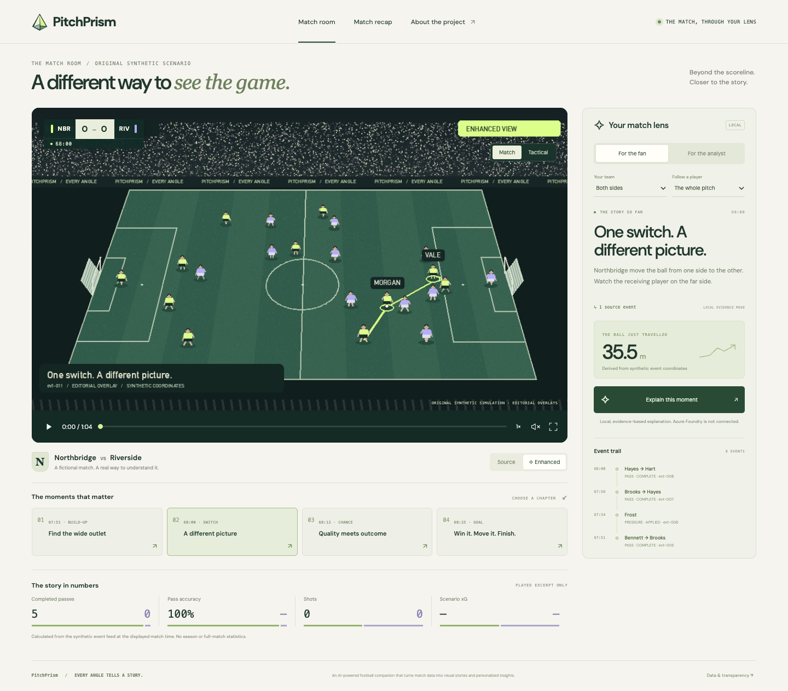

<div align="center">


# PitchPrism

**An AI-powered football companion that turns match data into visual stories and personalized insights.**

[Try the demo](https://imhaojie.github.io/PitchPrism/) · [Run locally](#run-locally) · [Microsoft integration](#microsoft-integration) · [Judge instructions](docs/football/JUDGING.md) · [Project pitch](docs/football/PITCH.md)



</div>

PitchPrism helps a fan see the pass before the chance, and helps an analyst inspect the events behind the story. Watch an original synthetic football sequence, pause on the diagonal switch, follow a player, or replay the finish. The evidence follows the source clock through enhanced video, tactical pauses and replays.

Northbridge AFC, Riverside United and their players are **fictional**. Events, coordinates, shot xG inputs and video are original synthetic material. No official Premier League data or footage is included.

## What works

- **Watch:** a 48-second software-rendered source sequence and a 64-second enhanced cut, with player labels, pass paths, pause and replay. All overlays are editorial.
- **Understand:** excerpt-only completed passes, pass accuracy, shot counts, scenario xG and pass distance, computed from the events already played. Missing values remain missing.
- **Personalize:** fan/analyst explanations, team selection and player focus change the event trail and narrative. Team totals retain their stated scope.
- **Inspect:** source event IDs, normalized coordinates, formulas and the distinction between facts and interpretation remain visible.
- **Use Foundry:** an actual Azure OpenAI v1 adapter implements a bounded read-state → inspect-evidence → validate-story tool loop, using Entra ID / managed identity or a server-side API key.

**Current cloud status:** the adapter and deployment template are implemented; no successful live Foundry call or Azure deployment is claimed yet. The public Pages demo uses clearly labelled **LOCAL** evidence mode. It materializes the same Python calculations and templates and never simulates a successful cloud response.

## Run locally

Python 3.11+ is sufficient for the API/analytics. Generate the original media once with Pillow and FFmpeg:

```bash
git clone https://github.com/imhaojie/PitchPrism.git
cd PitchPrism
python3 -m venv .venv
.venv/bin/pip install -r product/football/requirements.txt
# Install FFmpeg using your platform's package manager.
.venv/bin/python product/football/scripts/render.py
.venv/bin/python -m product.football.server --port 4180
```

Open **http://127.0.0.1:4180/**. No Azure account is needed for local evidence mode; the frontend needs no npm installation. Generated media stays outside Git and is attached to the demo release when available.

Space plays/pauses; arrow keys move along the source timeline. Source/enhanced switching preserves the original moment. Tactical view displays supplied synthetic coordinates, not optical tracking.

## Microsoft integration

The active football runtime has **no AWS dependency**. Its Foundry adapter uses Microsoft's [OpenAI v1 API](https://learn.microsoft.com/en-us/azure/ai-foundry/openai/api-version-lifecycle). The deployment target is **Azure Container Apps Consumption**, with managed identity, HTTPS, scale-to-zero, one maximum replica and bounded model calls. Bicep also defines a Foundry resource, project and on-demand model deployment. No GPUs or training are needed.

```bash
cp .env.example .env
# Set AZURE_OPENAI_ENDPOINT and AZURE_OPENAI_DEPLOYMENT in .env.
# For keyless local access: az login; assign Cognitive Services OpenAI User.
.venv/bin/python product/football/scripts/verify_foundry.py
```

Only a real model response that passes the tool contract produces a live verification receipt. See [Azure setup](infra/azure/README.md) for subscription, quota, deployment and cost boundaries.

```text
Synthetic events → deterministic football state → evidence IDs
                                                  ↓
                         local editorial mode / Azure Foundry tool loop
                                                  ↓
                         numeric + source-time + reference validation
                                                  ↓
                synchronized stories, facts, tactical map and enhanced video
```

## Verification

```bash
npm ci --prefix product --ignore-scripts
python3 product/scripts/check.py --full
```

The gate includes 32 new football tests plus 514 inherited product tests, privacy/syntax checks and legacy offline CDK assertions. Legacy CDK preserves the upstream snapshot; it does not certify Azure. Browser playback, MP4 full decode, Bicep compilation and live model verification are separate. See [validation](docs/football/VALIDATION.md).

`export_demo.py` materializes Python facts/local narratives into the same frontend. GitHub Actions renders the footage and publishes it to free Pages hosting. This static demo has no model credentials or live inference.

## Reuse and new work

PitchPrism adapts MIT-licensed [GameBuddy](https://github.com/imhaojie/BroadcastCode-2026), snapshot `17d74fd2a5df64a240198a7305312174de7684b0`. The original repository remains unchanged. The source tree is retained for provenance and regression testing; the active entry point is `product/football/`.

| Reused | Football adaptation |
|---|---|
| Native ESM player controls | Optional English accessibility; same playback, seeking, speed, volume and fullscreen |
| Source/output timeline functions | New synthetic sequence, pause and replay map |
| Viewing preference persistence | Separate PitchPrism namespace and fan/analyst settings |
| Evidence-first Agent pattern and guardrails | New football tools, provenance and Azure OpenAI transport |
| Video/verification approach | Original software-rendered football scene, enhanced MP4, hashes and full decode |
| Offline regression gate | Football analytics, HTTP and Agent contract tests added |

The **NBA × AWS silver award belongs to GameBuddy**, not PitchPrism. Rules require a new project, prohibit an already winning submission and permit open-source enhancements. Whether this adaptation qualifies must be confirmed with the organizers. [Official rules §4.3, §4.4, §4.11](https://github.com/microsoft/insidethegamehackathon/blob/main/OFFICIAL%20RULES.md).

Active code: `product/football/`. Shared components: `product/watch/`. Deployment: `infra/azure/`. New submission materials: `docs/football/`. The original introduction is preserved in [README-GAMEBUDDY.md](README-GAMEBUDDY.md); the basketball/AWS implementation is not the active football runtime.

Original code is MIT. DM Sans is SIL OFL. Preserved upstream materials follow [THIRD_PARTY_NOTICES.md](THIRD_PARTY_NOTICES.md) and are not used in the new football demo. PitchPrism is an independent project without Premier League endorsement.
